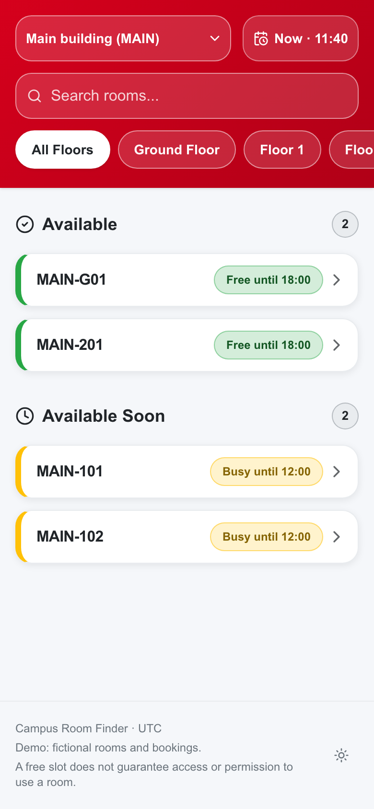
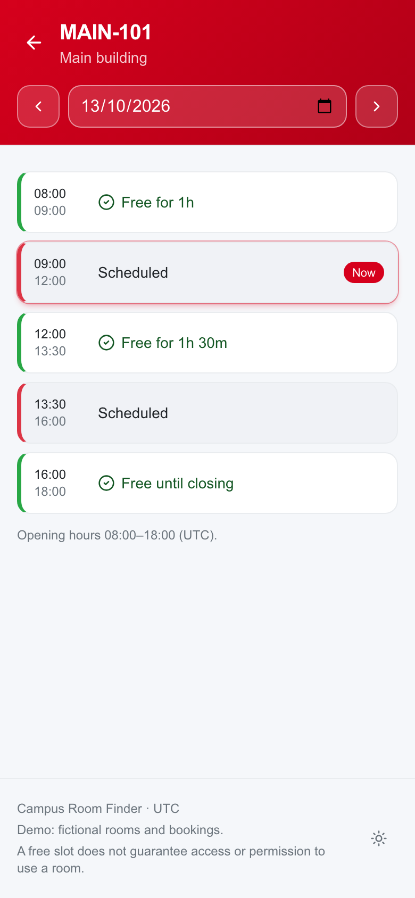
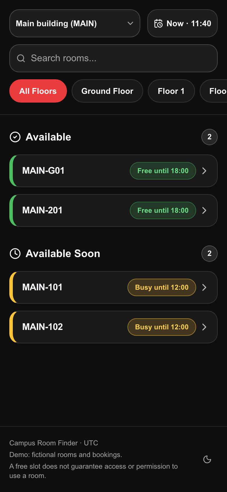
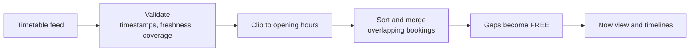

<div align="center">

# Campus Room Finder

**Which room is free right now, and where do I go if this one isn't?**

The open-source core of [FH Room Checker](https://fh-room-checker.vercel.app/): a mobile-first
room finder that turns any university timetable into live FREE / BUSY timelines.

[](https://github.com/Mseymur/FH_Room_Checker/actions/workflows/ci.yml)
[](LICENSE)


[**Live app**](https://fh-room-checker.vercel.app/) ·
[**Case study**](https://www.mseymur.com/projects/fh-room-checker) ·
[Quick start](#quick-start) ·
[Use it at your university](#use-it-at-your-university)

<br/>


&nbsp;

&nbsp;


<sub>Screenshots show this repository's built-in demo with fictional rooms and bookings.</sub>

</div>

---

## About

Timetables list when rooms are **busy**. Students want to know when they're **free**.
FH Room Checker started as a semester project, was validated with 25+ student testers, and grew
to around 200 regular users. This repository packages its core so any campus can run it:
the room UI, the interval engine that inverts bookings into free time, and a small adapter layer
for your own timetable feed.

It runs immediately with **fictional demo data**. No database, account, API key, analytics
service or university affiliation is required. It's a read-only schedule viewer; it doesn't book
rooms or measure physical occupancy.

## Features

- **Now view.** Rooms grouped into *Available*, *Available Soon* and *Busy*, sorted by how long
  they stay free (or how soon they free up).
- **Day timelines.** A FREE / BUSY timeline for every room, with day-by-day navigation.
- **Time travel.** Pick any date and time to plan ahead.
- **Filters and search.** Switch buildings, filter by floor, search by room (and by booking title,
  if you enable titles).
- **Live status.** The view updates every minute and keeps the current results on screen while
  the next update loads.
- **Light and dark themes**, mobile-first layout, keyboard and screen-reader friendly.
- **Strict data handling.** Feeds are validated server-side; anything incomplete, stale or
  malformed is an error, never an "everything is free" result.

## This repo vs. the production app

| | This repository | Production FH Room Checker |
|---|:---:|:---:|
| Room overview, timelines, time travel, themes | ✅ | ✅ |
| Interval engine (clip, merge, invert, DST-safe) | ✅ | ✅ |
| Data source | Demo, JSON file or HTTPS API | Supabase, synced every 2 hours |
| Teacher Finder, feedback, analytics | — | ✅ |
| Institution data and branding | — (fictional) | ✅ |

## Quick start

Requires Node.js 22.12 or newer.

```sh
cd frontend
npm ci
npm run dev
```

Open <http://localhost:3000>, choose a building and browse rooms. Demo mode is labelled in the
footer, and the default campus timezone is UTC.

## Use it at your university

1. **Describe your campus** in [`frontend/campus.config.json`](frontend/campus.config.json):
   app name, IANA timezone, same-day opening hours, buildings and the full list of rooms.
2. **Point it at your timetable.** Copy `frontend/.env.example` to `frontend/.env.local`, choose
   `file` or `api` mode and set the server-only path or URL. Credentials only ever live in
   `.env.local` or your host's environment.
3. **Map your feed** to the small [schedule contract](docs/ADAPTERS.md). A compatible JSON feed
   works as is. Other JSON shapes, CSV, XML or iCalendar need an adapter in
   `frontend/lib/adapters/`.
4. **Test and deploy.** The [setup guide](docs/SETUP.md) covers deployment, and the
   [AI adaptation prompt](docs/ADAPT_WITH_AI.md) helps an assistant write your adapter.

Booking titles are hidden by default, and instructor or student data is never part of the contract.

## How a schedule becomes free rooms



With opening hours `08:00–18:00` and bookings `09:00–10:00` and `09:30–11:00`:

| 08:00–09:00 | 09:00–11:00 | 11:00–18:00 |
|:---:|:---:|:---:|
| 🟢 FREE | 🔴 BUSY | 🟢 FREE |

A busy room that frees up within the configured threshold (30 minutes by default) shows as
**Available Soon**; a booking that runs until closing never does.

An empty booking list proves a room is free **only if the feed explicitly covers that room and
the whole opening-hours window**. Missing coverage shows no result, and invalid or stale feeds
show an error. Access restrictions and unrecorded bookings are outside the tool's knowledge.

## Tech stack

| Layer | Tools |
|---|---|
| App | Next.js 16 (App Router), React 19, TypeScript |
| UI | Tailwind CSS v4, shadcn/ui (Radix), lucide icons, next-themes |
| Data | TanStack Query v5, server-side adapters, in-memory cache |
| Quality | Vitest, ESLint (incl. jsx-a11y), Playwright demo flow, GitHub Actions |

## Project structure

```text
frontend/
├── app/                  pages and the /api/rooms route
├── components/           overview, room and shared UI components
├── hooks/                live clock, room queries, selected building
├── lib/
│   ├── adapters/         demo, file and API sources, plus feed validation
│   ├── availability.ts   bookings → FREE/BUSY intervals
│   └── time/             timezone and DST-safe time helpers
└── campus.config.json    your buildings, rooms and opening hours
docs/                     setup, adapter contract, AI adaptation prompt
```

## Checks

```sh
cd frontend
npm run lint && npm run typecheck && npm test && npm run build
npm audit --omit=dev
cd .. && python3 scripts/release.py --check
```

CI runs all of these plus a [gitleaks](https://github.com/gitleaks/gitleaks) secret scan of the
full Git history. With a server running, `npm run test:e2e` walks the demo in a real browser.

## Security and privacy

Provider URLs and tokens stay on the server, feeds are fetched over HTTPS without following
redirects, responses are size-limited, and the public API returns generic errors only. See
[`SECURITY.md`](SECURITY.md) for the full model and how to report a vulnerability.

## Credits

Built by [Seymur Mammadov](https://www.mseymur.com), with design contributions by Jakob Schnurrer.
Read the [V2 case study](https://www.mseymur.com/projects/fh-room-checker) or the
[V1 case study](https://mseymur.framer.website/projects/fh-room-checker-v1).

## License

[MIT](LICENSE). Third-party UI notices are in [`THIRD_PARTY_NOTICES.md`](THIRD_PARTY_NOTICES.md).
Schedule providers retain the rights to their data.
